R órák
================
Rácz, Péter; Lukics, Kriszti
2026-11-06

# Sillabusz: Kezdő R

1.  Bevezetés az adatkezelésbe

- select
- filter
- arrange
- mutate

2.  Bevezetés az adatvizualizációba

- ggplot
- aes
- geom

3.  Leíró statisztikák készítése

- group by
- mutate
- summarise

4.  Adatvizualizáció alapok

- faceting
- smooth
- legend
- axis

5.  Takaros adatok
6.  Széles és hosszú adatformátumok
7.  További adatformátumok
8.  Projektmunka
9.  Haladó adatvizualizáció
10. Adatkommunikáció: RMarkdown

# Sillabusz: Haladó R

1.  lineáris regresszió

- elmélet
  - jel és zaj, inferencia és jóslás
  - ki négyzet próba, t próba, anova, akármi: helyett hierarchikus
    általánosított lineáris modellek
  - mi lesz: lineáris modell, többértékű ~, általánosított ~,
    hierarchikus ~, modellválasztás, modellkritika, jóslás, ábrázolás,
    munkafolyamatok
  - mi nem lesz: matek, p értékek, más módszerek, alap programozás
  - együtthatók
  - maradékok
  - metszéspont és meredekség
  - faktorok
- gyakorlat:
  - `read_delim`
  - `ggplot`
  - `geom_smooth(method = 'lm')`
  - `lm()`
- házi
  - Datacamp::Introduction_to_Regression::Chapter_1

2.  jóslás

- elmélet:
  - predikció és extrapoláció
- gyakorlat
  - `summary()`
  - `glance()`
  - `predict()`
- házi
  - Datacamp::Introduction_to_Regression::Chapter_2

3.  diagnosztika

- elmélet:
  - r^2 és RSE
  - AIC és BIC
  - linearitás, homoszkedaszticitás, invariancia, a hibák függetlensége
  - Ascombe’s quartet
- gyakorlat:
  - `performance::model_performance()`
- házi:
  - Datacamp::Introduction_to_Regression::Chapter_3

4.  logisztikus regresszió

- elmélet:
  - általánosított lineáris modellek
  - véletlen komponens, kapcsolati függvény
  - p, oddszok, log oddsz
- gyakorlat:
  - `glm()`
  - `qlogis(), plogis(), exp()`
- házi:
  - Datacamp::Introduction_to_Regression::Chapter_4

5.  többszörös lineáris regresszió: numer + faktor

- elmélet:
  - alul- és túlillesztés
    - szabadságfok\
  - több metszéspont
- gyakorlat:
  - `1 + a`, `0 + a`
  - `performance::compare_performance()`
  - `anova()`
- házi:
  - Datacamp::Intermediate_Regression::Chapter_1

6.  többszörös lineáris regresszió: numer \* faktor

- elmélet:
  - több meredekség
  - Simpson paradoxona
  - interakciók
- gyakorlat:
  - `a*b`, `a:b`
- házi:
  - Datacamp::Intermediate_Regression::Chapter_2

7.  többszörös lineáris regresszió: numer \* numer

- elmélet:
  - többfokú meredekség
- gyakorlat:
- `geom_density`, `facet_wrap`
- házi:
  - Datacamp::Intermediate_Regression::Chapter_3

8.  többszörös logisztikus regresszió

- elmélet:
  - interakciók, kumulatív oddszok
- gyakorlat:
  - `sec.axis`
- házi:
  - Datacamp::Intermediate_Regression::Chapter_4

9.  hierarchikus általánosított lineáris modellek: random metszéspontok

- elmélet:
- gyakorlat:
- résztvevőszintű adatok és megfigyelésszintű adatok
- glmmTMB()
- broom.mixed
- residual r^2, conditional r^2
- házi:
  - Datacamp::Hierarchical_Regression::Chapter_1

10. hierarchikus általánosított lineáris modellek: random meredekségek

- elmélet:
  - random meredekségek
- gyakorlat:
  - `(1|a)`, `(1 + b|a)`
- házi:
  - Datacamp::Hierarchical_Regression::Chapter_2

11. hierarchikus általánosított lineáris modellek: ismételt mérések

- elmélet:
  - anova, manova, paired t teszt
- gyakorlat:
  - `(1|item)`, `(1|participant)`
- házi:
  - Datacamp::Hierarchical_Regression::Chapter_4

# Hasznos linkek

[itt.](https://peterracz.wordpress.com/teaching/intro-r-bevezetes-az-r-programozasba/)

# Acknowledgement

This class is supported by DataCamp, the most intuitive learning
platform for data science and analytics. Learn any time, anywhere and
become an expert in R, Python, SQL, and more. DataCamp’s learn-by-doing
methodology combines short expert videos and hands-on-the-keyboard
exercises to help learners retain knowledge. DataCamp offers 350+
courses by expert instructors on topics such as importing data, data
visualization, and machine learning. They’re constantly expanding their
curriculum to keep up with the latest technology trends and to provide
the best learning experience for all skill levels. Join over 6 million
learners around the world and close your skills gap.

# Kisokos

Az órán tanultak, egy helyen.

## 0. Milyen package-ekre (library-kre) lesz szükségünk?

``` r
library(tidyverse) # tidyverse csomagok, select/filter/arrange/mutate/summarise, ggplot
library(broom.mixed) # tidy, glance, augment
library(performance) # modellösszehasonlítgatás
library(sjPlot) # modell becsléseinek ábrázolása
library(glmmTMB) # hierarchikus / kevert lineáris modellek
```

## 1. Ábrázolás, térképezés (exploratory data analysis)

A `ggplot2`-vel csomagolt `msleep` adathalmazt fogjuk használni. Ez 83
emlősfaj alvási szokásait és testméreteit tartalmazza: van folytonos
célváltozónk (napi alvásidő órában, `sleep_total`), folytonos
prediktoraink nagyon különböző skálákon (testsúly és agy súlya
kilogrammban, hat nagyságrendben), egy kategoriális prediktorunk
(étrendtípus, `vore`: húsevő/növényevő/rovarevő/mindenevő), és egy
csoportosító változónk (rendszertani rend, `order`). Az utóbbi háromnban
vannak hiányzó mérések is. Ez egy igazi adatsor.

``` r
str(msleep)
```

    ## tibble [83 × 11] (S3: tbl_df/tbl/data.frame)
    ##  $ name        : chr [1:83] "Cheetah" "Owl monkey" "Mountain beaver" "Greater short-tailed shrew" ...
    ##  $ genus       : chr [1:83] "Acinonyx" "Aotus" "Aplodontia" "Blarina" ...
    ##  $ vore        : chr [1:83] "carni" "omni" "herbi" "omni" ...
    ##  $ order       : chr [1:83] "Carnivora" "Primates" "Rodentia" "Soricomorpha" ...
    ##  $ conservation: chr [1:83] "lc" NA "nt" "lc" ...
    ##  $ sleep_total : num [1:83] 12.1 17 14.4 14.9 4 14.4 8.7 7 10.1 3 ...
    ##  $ sleep_rem   : num [1:83] NA 1.8 2.4 2.3 0.7 2.2 1.4 NA 2.9 NA ...
    ##  $ sleep_cycle : num [1:83] NA NA NA 0.133 0.667 ...
    ##  $ awake       : num [1:83] 11.9 7 9.6 9.1 20 9.6 15.3 17 13.9 21 ...
    ##  $ brainwt     : num [1:83] NA 0.0155 NA 0.00029 0.423 NA NA NA 0.07 0.0982 ...
    ##  $ bodywt      : num [1:83] 50 0.48 1.35 0.019 600 ...

``` r
head(msleep)
```

    ## # A tibble: 6 × 11
    ##   name    genus vore  order conservation sleep_total sleep_rem sleep_cycle awake
    ##   <chr>   <chr> <chr> <chr> <chr>              <dbl>     <dbl>       <dbl> <dbl>
    ## 1 Cheetah Acin… carni Carn… lc                  12.1      NA        NA      11.9
    ## 2 Owl mo… Aotus omni  Prim… <NA>                17         1.8      NA       7  
    ## 3 Mounta… Aplo… herbi Rode… nt                  14.4       2.4      NA       9.6
    ## 4 Greate… Blar… omni  Sori… lc                  14.9       2.3       0.133   9.1
    ## 5 Cow     Bos   herbi Arti… domesticated         4         0.7       0.667  20  
    ## 6 Three-… Brad… herbi Pilo… <NA>                14.4       2.2       0.767   9.6
    ## # ℹ 2 more variables: brainwt <dbl>, bodywt <dbl>

Mindig nézzük meg azt is, van-e hiányzó adat (`NA`) a változóinkban, ezt
az `lm()` modellépítés előtt kell tisztázni, mert az lm csendben kidobja
az egész megfigyelést, ha valamilyen mérés hiányzik (lásd 2.0. pont).

``` r
colSums(is.na(msleep))
```

    ##         name        genus         vore        order conservation  sleep_total 
    ##            0            0            7            0           29            0 
    ##    sleep_rem  sleep_cycle        awake      brainwt       bodywt 
    ##           22           51            0           27            0

Nézzük meg azt is, hogyan viszonyulnak egymáshoz a különféle mért
mennyiségek. A testsúly és az agy súlya nagyon széles skálán mozog (van
itt denevér és bálna is, az egyik kisebb, mint a másik), ezért
log-skálán ábrázoljuk, különben semmit nem látnánk a scatterploton.

``` r
# testsúly x agysúly x étrend
ggplot(msleep, aes(x = bodywt, y = brainwt, color = vore)) +
  geom_point() +
  geom_smooth(method = 'lm', se = FALSE) +
  scale_x_log10() +
  scale_y_log10() +
  theme_minimal()
```

    ## `geom_smooth()` using formula = 'y ~ x'

<!-- -->

``` r
# testsúly x alvásidő x étrend
ggplot(msleep, aes(x = bodywt, y = sleep_total, color = vore)) +
  geom_point() +
  geom_smooth(method = 'lm', se = FALSE) +
  scale_x_log10() +
  theme_minimal()
```

    ## `geom_smooth()` using formula = 'y ~ x'

<!-- -->

``` r
# agysúly x alvásidő x étrend
ggplot(msleep, aes(x = brainwt, y = sleep_total, color = vore)) +
  geom_point() +
  geom_smooth(method = 'lm', se = FALSE) +
  scale_x_log10() +
  theme_minimal()
```

    ## `geom_smooth()` using formula = 'y ~ x'

<!-- -->

A testsúly és az agy súlya nagyon szorosan összefügg (r = 0.93) – minél
nagyobb az állat, annál nagyobb az agy. Mindkettő gyengén, de összefügg
az alvásidővel is (r = -0.31, illetve -0.36): a nagyobb testű / nagyobb
agyú állatok átlagosan kevesebbet alszanak. Az étrendtípus szerint is
van valamennyi szóródás, de a csoportok mérete jól átfedi egymást: pl.
vannak kisebb és nagyobb húsevők is.

------------------------------------------------------------------------

Több tidyverse [itt](https://www.tidyverse.org/). Több ggplot2
[itt](https://ggplot2.tidyverse.org/).

------------------------------------------------------------------------

## 2. Modellépítés

Mielőtt nekiállunk bármit modellezni, csinálunk egy csoportosító
változót. Az `order`-nek 19 szintje van, nagyon egyenetlenül elosztva: a
Rodentia 22 megfigyeléssel van jelen, több rendből viszont csak 1
megfigyelésünk van. Egy hierarchikus modellnél (lásd 2.2.) ebből baj
lesz: egyetlen megfigyelésből nem nagyon lehet csoportszintű varianciát
becsülni. Ezért a négy legnépesebb rendet megtartjuk külön csoportnak, a
többit egy “Egyéb” csoportba vonjuk össze:

``` r
msleep <- msleep |>
  mutate(order_grouped = fct_lump_n(order, n = 4, other_level = "Egyéb"))

table(msleep$order_grouped)
```

    ## 
    ## Artiodactyla    Carnivora     Primates     Rodentia        Egyéb 
    ##            6           12           12           22           31

### 2.0. Prediktorok előkészítése: skálázás és hiányzó adatok

Mielőtt modellt illesztünk, két dolgot érdemes átgondolni, mert az
`lm()` (és a `glmmTMB()`) nem fog miattuk hibát dobni, csak csendben
másként fog viselkedni. (Ez nagyon hasonló probléma ahhoz, hogy hogyan
kezelik a hiányzó méréseket – szó nélkül kivágják az egész
megfigyelést.)

**Skálázás.** Ha a prediktorok nagyon különböző skálán vannak, a becsült
együtthatóik nem hasonlíthatók össze közvetlenül, ami kollinearitási,
hierarchikus modellekben pedig konvergenciaproblémákat is okozhat. A
`scale()` függvénnyel standardizálhatjuk a prediktorokat (átlag = 0,
szórás = 1):

``` r
msleep_scaled <- msleep |>
  mutate(bodywt_z = scale(bodywt), brainwt_z = scale(brainwt))

lm_raw <- lm(sleep_total ~ bodywt + brainwt, data = msleep)
lm_scaled <- lm(sleep_total ~ bodywt_z + brainwt_z, data = msleep_scaled)

tidy(lm_raw) |> knitr::kable('simple', digits = 3)
```

| term        | estimate | std.error | statistic | p.value |
|:------------|---------:|----------:|----------:|--------:|
| (Intercept) |   10.672 |     0.590 |    18.093 |   0.000 |
| bodywt      |    0.001 |     0.002 |     0.476 |   0.636 |
| brainwt     |   -2.352 |     1.618 |    -1.454 |   0.152 |

``` r
tidy(lm_scaled) |> knitr::kable('simple', digits = 3)
```

| term        | estimate | std.error | statistic | p.value |
|:------------|---------:|----------:|----------:|--------:|
| (Intercept) |   10.142 |     0.564 |    17.994 |   0.000 |
| bodywt_z    |    0.626 |     1.314 |     0.476 |   0.636 |
| brainwt_z   |   -2.296 |     1.580 |    -1.454 |   0.152 |

Figyeljük meg, hogy a nyers modellben a bodywt együtthatója (0.001)
elhanyagolhatónak néz ki a brainwt együtthatója (-2.35) mellett – ez
alapján azt gondolhatnánk, hogy a testsúlynak majdhogynem nincs hatása.
Ez csak a mértékegység trükkje: a bodywt kilogrammban simán 6000 fölé
megy, a brainwt kilogrammban 6 alatt marad, ezért egy “egy kilónyi
különbség” óriási dolog az egyiknél és apró a másiknál. Skálázás után
(szórásegységben kifejezve) a két hatás összevethető nagyságrendbe kerül
(0.626 vs. -2.30) – a testsúly hatása koránt sem olyan elhanyagolható,
mint ahogyan a nyers együttható alapján tűnt.

**Hiányzó adatok.** Ha egy sorban a modellbe bekerülő változók közül
legalább egy `NA`, az `lm()` (alapértelmezésben, `na.action = na.omit`)
egyszerűen kihagyja azt a sort – hiba vagy figyelmeztetés nélkül. Itt ez
nem kitalált demó: az agy súlya tényleg hiányzik a fajok egy részénél.

``` r
lm_na_demo <- lm(sleep_total ~ brainwt, data = msleep)

nrow(msleep)
```

    ## [1] 83

``` r
nobs(lm_na_demo)
```

    ## [1] 56

A `nrow()` és a `nobs()` közti különbség (83 vs. 56) megmutatja, hány
sort dobott ki a modell – ezt mindig érdemes ellenőrizni modellépítés
után, különösen akkor, ha nem véletlenszerűen hiányoznak adatok (pl. egy
adott csoportban szisztematikusan hiányzik egy mérés, mondjuk csak az
egereknek nem mérték meg a testsúlyát, mert elszaladtak, miközben a
bálna megült a mérlegen), mert ilyenkor a modell torzított becslést fog
adni.

------------------------------------------------------------------------

### 2.1. Lineáris modell

Most főleg a napi alvásidőt (`sleep_total`) fogjuk jósolgatni a
testsúlyból (`bodywt`).

Szintaxis:

``` r
# sima lineáris modell: y = a + b * x
lm1 <- lm(sleep_total ~ bodywt, data = msleep)
# többváltozós lineáris modell: faktor és numerikus prediktor: y = a1 / a2 / ... / a5 + b * x
lm2 <- lm(sleep_total ~ order_grouped + bodywt, data = msleep)
# interakció: faktor és numerikus prediktor: y = a1 + b1 * x / a2 + b2 * x / ...
lm3 <- lm(sleep_total ~ order_grouped * bodywt, data = msleep)
# interakció: két numerikus prediktor:
lm4 <- lm(sleep_total ~ bodywt * brainwt, data = msleep)
# persze egy lineáris modellben lehet akárhány prediktor:
lm5 <- lm(sleep_total ~ bodywt + brainwt + order_grouped, data = msleep)
```

### 2.2. Hierarchikus lineáris modell

Szintaxis:

``` r
# grouping faktor / random intercept:
lmm1 <- glmmTMB(sleep_total ~ bodywt + (1 | order_grouped), data = msleep)
# grouping faktor és saját slope / random intercept és random slope:
lmm2 <- glmmTMB(sleep_total ~ bodywt + (1 + bodywt | order_grouped), data = msleep)
```

### 2.3. Generalizált lineáris modell

Szintaxis:

``` r
# bináris válaszváltozó: húsevő vagy nem, binominalis eloszlás, logit linkfüggvény
msleep <- msleep |>
  mutate(carni = ifelse(vore == "carni", 1, 0))

glm1 <- glm(carni ~ bodywt, data = msleep, family = binomial(link = "logit"))

# persze ez is lehet hierarchikus modell

glmm1 <- glmmTMB(carni ~ bodywt + (1 | order_grouped), data = msleep, family = binomial(link = "logit"))
```

------------------------------------------------------------------------

Több glmmTMB [itt](https://glmmtmb.github.io/glmmTMB/).

------------------------------------------------------------------------

## 3. Modellkritika-diagnosztika

Három modell a komoly jelölt: az lm1, az lmm1 és az lmm2. Az lm2-t és az
lm3-at csak azért nézzük meg, hogy lássuk, mi történik, ha a csoportot
(order_grouped) fix hatásként, nem grouping faktorként vesszük be.
Emlékeztetőül:

``` r
formula(lm1)
```

    ## sleep_total ~ bodywt

``` r
formula(lm2)
```

    ## sleep_total ~ order_grouped + bodywt

``` r
formula(lm3)
```

    ## sleep_total ~ order_grouped * bodywt

``` r
formula(lmm1)
```

    ## sleep_total ~ bodywt + (1 | order_grouped)

``` r
formula(lmm2)
```

    ## sleep_total ~ bodywt + (1 + bodywt | order_grouped)

Megfeleltek a modellek a regresszió alapvetéseinek?

#### lm1

``` r
check_model(lm1)
```

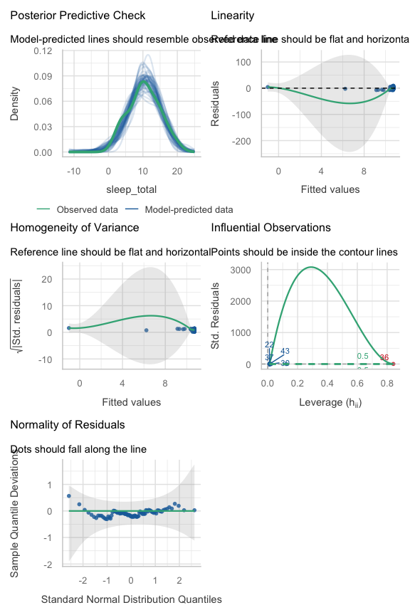<!-- -->

Az lm1 maradékai nem néznek ki rosszul: a variancia homogén (p = 0.71),
a maradékok eloszlása közelít a normálishoz (p = 0.22). Ez nem jelenti
azt, hogy a rendszertani csoport nem fontos, csak azt, hogy itt a
csoport hiánya nem okoz azonnal látható problémát a maradékokban.

#### lm2

``` r
check_model(lm2)
```

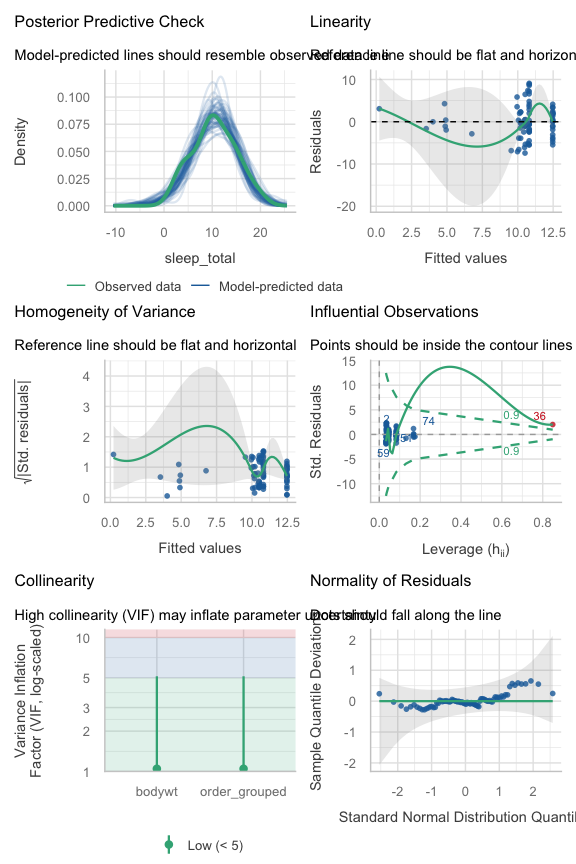<!-- -->

Az lm2-ben megengedtük, hogy a lineáris modellnek az öt csoportra (a
négy legnépesebb rendre plusz az “Egyéb”-re) különböző interceptje
legyen, de azt nem, hogy a slope is különböző legyen. A maradékok itt is
rendben vannak. A prediktorok közötti kollinearitás gyenge (VIF ≈ 1.05):
az “Egyéb” csoportba nagyon különböző méretű állatok kerültek
(denevértől a bálnáig), ezért a csoport nem helyettesíti automatikusan a
testsúlyt.

Vesd össze:

``` r
clm = lm(sleep_total ~ order_grouped, data = msleep)
tidy(clm) |>
  knitr::kable('simple', digits = 2)
```

| term                   | estimate | std.error | statistic | p.value |
|:-----------------------|---------:|----------:|----------:|--------:|
| (Intercept)            |     4.52 |      1.68 |      2.69 |    0.01 |
| order_groupedCarnivora |     5.60 |      2.06 |      2.72 |    0.01 |
| order_groupedPrimates  |     5.98 |      2.06 |      2.91 |    0.00 |
| order_groupedRodentia  |     7.95 |      1.89 |      4.20 |    0.00 |
| order_groupedEgyéb     |     5.72 |      1.84 |      3.11 |    0.00 |

#### lm3

``` r
check_model(lm3)
```

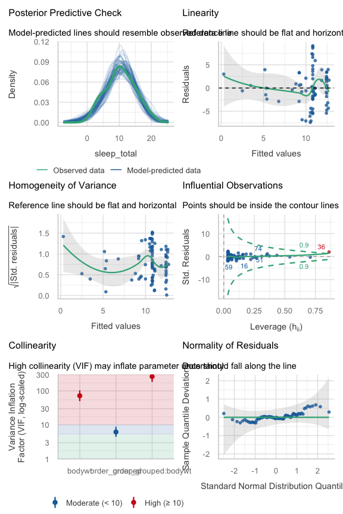<!-- -->

Az lm3-ban külön intercept és slope is van az öt csoportra. A VIF itt
már nagyon megugrik, de ez nagyrészt technikai okból van: az interakciós
tagot nem centráltuk, ami felfújja a VIF-et (a `check_collinearity()` is
figyelmeztet erre). A maradékok egyébként itt is rendben vannak.

#### lmm1

``` r
check_model(lmm1)
```

    ## `check_outliers()` does not yet support models of class `glmmTMB`.

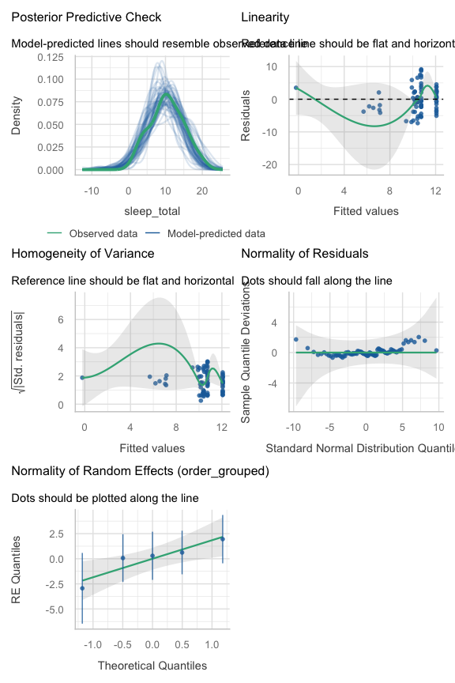<!-- -->

Minket igazából nem az order_grouped hatása érdekel. Minket az érdekel,
hogy a testsúly megjósolja-e az alvásidőt, az összes emlősre nézve.
Viszont a rendszertani rend fontos eleme az adatok hierarchiájának (a
rokon fajok hasonlóbbak egymáshoz, mint a távoliak), ezért az lmm1-ben
az order_grouped-ot grouping faktornak tesszük be. A maradékok hasonlóan
néznek ki, mint az lm1-nél, de most a csoportok közti eltérést nem
akarjuk “megmagyarázni” fix hatásként, csak figyelembe venni.

#### lmm2

``` r
check_model(lmm2)
```

    ## `check_outliers()` does not yet support models of class `glmmTMB`.

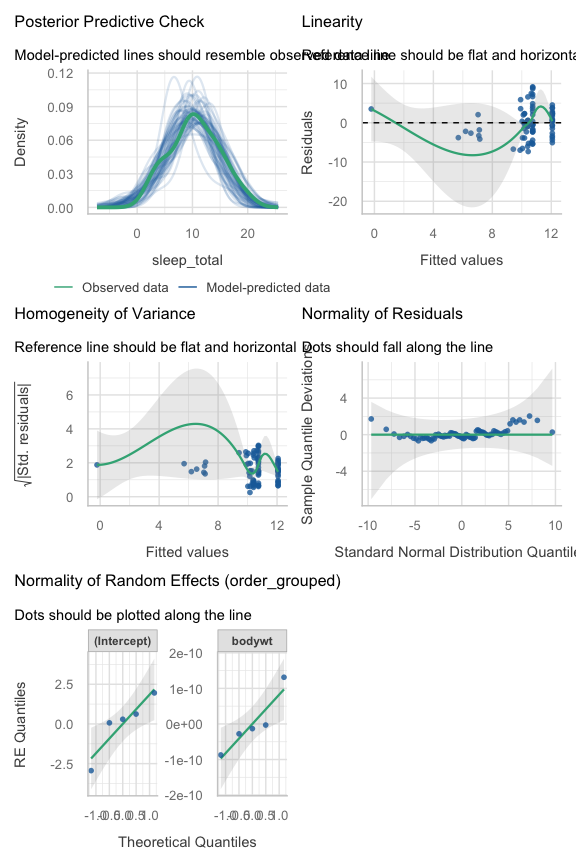<!-- -->

Az lmm2-ben a slope is csoportonként különböző lehet. A maradékok itt is
rendben vannak, de az intercept-only lmm1-hez képest nincs érdemi
javulás.

**Melyik modell a jobb?**

``` r
compare_performance(lm1, lmm1, lmm2) |>
  knitr::kable('simple', digits = 2)
```

    ## Random effect variances not available. Returned R2 does not account for random effects.

| Name | Model | AIC | AIC_wt | AICc | AICc_wt | BIC | BIC_wt | RMSE | Sigma | R2_conditional | R2_marginal | R2 | R2_adjusted | ICC |
|:---|:---|---:|---:|---:|---:|---:|---:|---:|---:|---:|---:|---:|---:|---:|
| lm1 | lm | 479.87 | 0.30 | 480.18 | 0.33 | 487.13 | 0.62 | 4.20 | 4.25 | NA | NA | 0.1 | 0.09 | NA |
| lmm1 | glmmTMB | 478.47 | 0.61 | 478.98 | 0.61 | 488.15 | 0.37 | 3.85 | 3.94 | 0.25 | 0.08 | NA | NA | 0.18 |
| lmm2 | glmmTMB | 482.47 | 0.08 | 483.58 | 0.06 | 496.98 | 0.00 | 3.85 | 3.94 | NA | 0.10 | NA | NA | NA |

``` r
plot(compare_performance(lm1, lmm1, lmm2))
```

    ## Random effect variances not available. Returned R2 does not account for random effects.

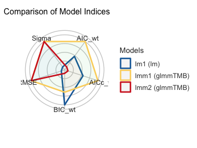<!-- -->

Az AIC enyhén az lmm1-et preferálja (478.5 vs. 479.9), a BIC – ami
jobban büntet a komplexitásért – viszont az lm1-et (487.1 vs. 488.1).
Nézzük meg formálisan is, likelihood ratio teszttel, hogy a hierarchikus
modell szignifikánsan jobban illeszkedik-e, mint a sima lineáris modell:

``` r
test_likelihoodratio(lm1,lmm1) |>
  knitr::kable('simple', digits = 2)
```

|      | Name | Model   |  df | df_diff | Criterion | Chi2 |    p |
|------|:-----|:--------|----:|--------:|----------:|-----:|-----:|
| lm1  | lm1  | lm      |   3 |      NA |    473.87 |   NA |   NA |
| lmm1 | lmm1 | glmmTMB |   4 |       1 |    470.47 |  3.4 | 0.07 |

A p-érték (0.065) szorosan 0.05 fölött van: szigorúan véve az lmm1 nem
illeszkedik szignifikánsan jobban, mint az lm1. Ez jó emlékeztető arra,
hogy a hierarchikus modell nem mindig nyer egyértelműen: mivel az
“Egyéb” csoportba sok, egymástól nagyon különböző rend került, a
csoporthatás felhígul. Ettől függetlenül jó okunk van arra, hogy inkább
a hierarchikus modellt válasszuk, de ez az ok itt elméleti - prior:
számítunk arra, hogy a rendszertani rokonság befolyásolja az
alvásszokásokat (pl. közös evolúciós történet miatt). Emellett egy
véletlen metszéspont nem sok szabadságfokot “költ”, és az AIC enyhén
emellett is szól.

Biztonság kedvéért hasonlítsuk össze csupán a két hierarchikus modellt
egymással.

``` r
compare_performance(lmm1, lmm2) |>
  knitr::kable('simple', digits = 2)
```

    ## Some of the nested models seem to be identical and probably only vary in
    ##   their random effects.

    ## Random effect variances not available. Returned R2 does not account for random effects.

| Name | Model | AIC | AIC_wt | AICc | AICc_wt | BIC | BIC_wt | R2_conditional | R2_marginal | RMSE | Sigma | ICC |
|:---|:---|---:|---:|---:|---:|---:|---:|---:|---:|---:|---:|---:|
| lmm1 | glmmTMB | 478.47 | 0.88 | 478.98 | 0.91 | 488.15 | 0.99 | 0.25 | 0.08 | 3.85 | 3.94 | 0.18 |
| lmm2 | glmmTMB | 482.47 | 0.12 | 483.58 | 0.09 | 496.98 | 0.01 | NA | 0.10 | 3.85 | 3.94 | NA |

``` r
plot(compare_performance(lmm1, lmm2))
```

    ## Some of the nested models seem to be identical and probably only vary in
    ##   their random effects.

    ## Random effect variances not available. Returned R2 does not account for random effects.

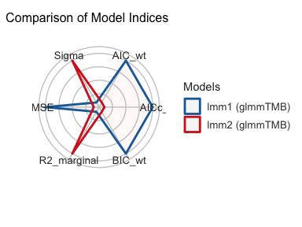<!-- -->

A két hierarchikus (kevert) modell közül is az lmm1 tűnik jobbnak, főleg
azoknak a mérőszámoknak az alapján, amelyek a komplexitást büntetik
(AIC, BIC). Csináljunk egy likelihood ratio tesztet, ami megmondja, hogy
melyik modell illeszkedik jobban az adatokra:

``` r
test_likelihoodratio(lmm1,lmm2) |>
  knitr::kable('simple', digits = 2)
```

    ## Some of the nested models seem to be identical and probably only vary in
    ##   their random effects.

|      | Name | Model   |  df | df_diff | Criterion | Chi2 |   p |
|------|:-----|:--------|----:|--------:|----------:|-----:|----:|
| lmm1 | lmm1 | glmmTMB |   4 |      NA |    470.47 |   NA |  NA |
| lmm2 | lmm2 | glmmTMB |   6 |       2 |    470.47 |    0 |   1 |

A Chi2 majdnem pontosan nulla, a p-value jóval 0.05 fölött van, tehát az
lmm2 nem illeszkedik szignifikánsan jobban az adatokra, mint az lmm1: a
csoportonként eltérő slope itt semmit nem dob hozzá.

------------------------------------------------------------------------

Több modellkritika [itt](https://easystats.github.io/performance/).

------------------------------------------------------------------------

## 4. Modell értelmezése, vizualizáció

``` r
summary(lmm1)
```

    ##  Family: gaussian  ( identity )
    ## Formula:          sleep_total ~ bodywt + (1 | order_grouped)
    ## Data: msleep
    ## 
    ##       AIC       BIC    logLik -2*log(L)  df.resid 
    ##     478.5     488.1    -235.2     470.5        79 
    ## 
    ## Random effects:
    ## 
    ## Conditional model:
    ##  Groups        Name        Variance Std.Dev.
    ##  order_grouped (Intercept)  3.469   1.863   
    ##  Residual                  15.525   3.940   
    ## Number of obs: 83, groups:  order_grouped, 5
    ## 
    ## Dispersion estimate for gaussian family (sigma^2): 15.5 
    ## 
    ## Conditional model:
    ##               Estimate Std. Error z value Pr(>|z|)    
    ## (Intercept) 10.1166133  0.9908771  10.210  < 2e-16 ***
    ## bodywt      -0.0016463  0.0005649  -2.914  0.00356 ** 
    ## ---
    ## Signif. codes:  0 '***' 0.001 '**' 0.01 '*' 0.05 '.' 0.1 ' ' 1

A summary függvény kiirogatja az R konzolba a modell fő paramétereit. Ez
jó, csak nehéz berakni mondjuk egy táblázatba.

A tidy függvény kevesebb információt közöl, de takarosabb.

``` r
tidy(lmm1, conf.int = T) |>
  knitr::kable('simple', digits = 2)
```

| effect | component | group | term | estimate | std.error | statistic | p.value | conf.low | conf.high |
|:---|:---|:---|:---|---:|---:|---:|---:|---:|---:|
| fixed | cond | NA | (Intercept) | 10.12 | 0.99 | 10.21 | 0 | 8.17 | 12.06 |
| fixed | cond | NA | bodywt | 0.00 | 0.00 | -2.91 | 0 | 0.00 | 0.00 |
| ran_pars | cond | order_grouped | sd\_\_(Intercept) | 1.86 | NA | NA | NA | 3.36 | 4.62 |
| ran_pars | cond | Residual | sd\_\_Observation | 3.94 | NA | NA | NA | NA | NA |

Itt jön vissza a 2.0. pontban már látott probléma: a bodywt becslése,
hibája és konfidenciaintervalluma mind 0.00-nak néz ki 2 tizedesjegyre
kerekítve, pedig a statisztika és a p-érték szerint a hatás egyértelműen
szignifikáns. Ez nem hiba, csak a mértékegység (kilogramm, 6000-es
skálán) miatt van – `digits = 2` helyett `digits = 4`-gyel, vagy
skálázott prediktorral ez nem történne meg.

Ábrázoljuk a modell becsléseit.

``` r
plot_model(lmm1, 'est')
```

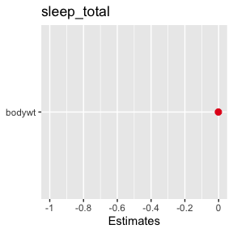<!-- -->

Hát itt egy “b” van, a bodywt, szóval ez nem túl érdekes. Nézzünk meg
egy modellt, amiben sok van.

``` r
plot_model(lm5, 'est')
```

    ## Warning: Using `size` aesthetic for lines was deprecated in ggplot2 3.4.0.
    ## ℹ Please use `linewidth` instead.
    ## ℹ The deprecated feature was likely used in the sjPlot package.
    ##   Please report the issue at <https://github.com/strengejacke/sjPlot/issues>.
    ## This warning is displayed once per session.
    ## Call `lifecycle::last_lifecycle_warnings()` to see where this warning was
    ## generated.

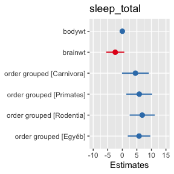<!-- -->

Vigyázat: itt a bodywt és a brainwt nagyon különböző skálán vannak (lásd
2.0. pont), és ez az ábrán is látszik – az egyik becslés és
konfidenciaintervallum eltörpül a másik mellett, noha ezt csak a
mértékegységük okozza. Ábrázolás előtt is érdemes skálázni a
prediktorokat (`pred = scale(pred)`), hogy a becslések összevethetők
legyenek.

Ábrázoljuk a modell predikcióit.

``` r
plot_model(lmm1, 'pred')
```

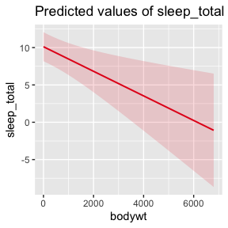<!-- -->

Predikciók ábrázolása több prediktor esetén. A `plot_model` mindig a
kimeneti változóra tett jóslatot teszi az y tengelyre, az első megadott
term-et (prediktort) teszi az x tengelyre, és a többi megadott term
szerint bont. Ha a második (harmadik) term egy folyamatos változó, akkor
csinál belőle három bödönt, és ábrázolja azokat. (A bodywt és a brainwt
itt is erősen összefügg egymással, ezért ne vonjunk messzemenő
következtetést a lm4 predikcióiból – ezek a példák inkább arra jók, hogy
gyakoroljuk a szintaxist.)

``` r
plot_model(lm3, 'pred', terms = c('bodywt','order_grouped'))
```

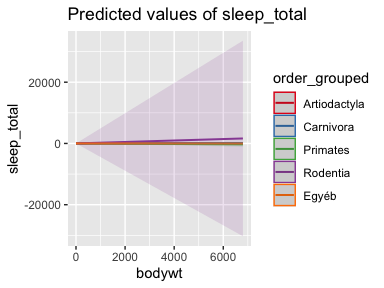<!-- -->

``` r
plot_model(lm3, 'pred', terms = c('order_grouped','bodywt'))
```

    ## Ignoring unknown labels:
    ## • linetype : "bodywt"
    ## • shape : "bodywt"

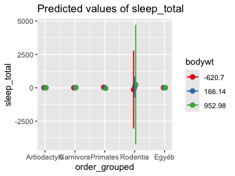<!-- -->

``` r
plot_model(lm4, 'pred', terms = c('bodywt','brainwt'))
```

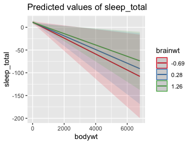<!-- -->

``` r
plot_model(lm4, 'pred', terms = c('brainwt','bodywt'))
```

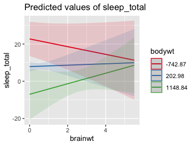<!-- -->

Hierarchikus / kevert modellek esetén ábrázolhatjuk a random
intercepeket és slope-okat is.

``` r
plot_model(lmm1, 're')
```

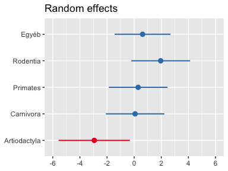<!-- -->

``` r
plot_model(lmm2, 're')
```

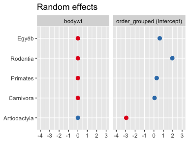<!-- -->

------------------------------------------------------------------------

Több sjplot [itt](https://strengejacke.github.io/).

------------------------------------------------------------------------

## 5. További szempontok

Az eddigi munkafolyamat a hierarchikus lineáris modellek legegyszerűbb,
“alap” verzióját mutatta be. Néhány dolog, amit érdemes észben tartani,
ha ennél messzebb akarunk menni (vagy éppen nem akarunk, és tudni
akarjuk, miért nem).

**Megfigyelés-szintű random intercept.** A grouping factor nem csak
olyan kategória lehet, amiből több megfigyelésünk van csoportonként
(mint itt az order_grouped): ha minden megfigyelésnek saját szintet
adunk (`(1 | obs_id)`, ahol `obs_id` egyedi azonosító minden sorhoz),
azt megfigyelés-szintű random interceptnek (observation-level random
effect, OLRE) hívják. Ezt gyakran használják számlálásos (count)
adatoknál túlszórás (overdispersion) kezelésére Poisson-modellekben –
nálunk ez nem releváns, mert a sleep_total nem számlálásos változó, de
jó tudni, hogy a “grouping factor” fogalma ide is kiterjed.

**Filogenetikai struktúra.** Az order_grouped egy nagyon lecsupaszított
módja annak, hogy a fajok közti rokonságot figyelembe vegyük: a modell
úgy kezeli az öt csoportot, mintha egymástól egyformán függetlenek
lennének, de ez nem igaz, mert az evolúciós fa ágai más és más
távolságra vannak egymástól – a Primates közelebbi rokona a
Carnivorának, mint a Cetaceának (ami nálunk az “Egyéb” csoportba esett).
A lineáris modell ezt is tudja kezelni, csak nem ilyen egyszerűen:
filogenetikai fastruktúrát (evolúciós távolságot) is be lehet építeni a
modellbe kovariancia-struktúraként. Ez messze túlmegy ennek a kurzusnak
a keretein, de jó emlékeztető, hogy a lineáris modell, mint keret,
meglepően sokáig kitart, ha az ember hajlandó bővíteni a struktúráját.

**Hiányzó adatok imputációja és rezidualizálás: ne.** Két gyakori trükk
hiányzó vagy kollineáris adatra: az imputáció (a hiányzó értéket egy
modell “kitalálja” helyettünk), illetve a rezidualizálás (az egyik
kollineáris prediktort rávetítjük a másikra, és csak a maradékát
használjuk prediktorként). A közös szál a kettőben, hogy mindkettő olyan
információt termel, amivel valójában nem rendelkezünk – vagy kitaláljuk
a hiányzó értéket, vagy szétszálazzuk két változó közös varianciáját
úgy, mintha tudnánk, melyik rész kinek a “sajátja”. Ezen a kurzuson a
tanács egyszerű: ne csináld. Az imputáció egy (általában
ellenőrizhetetlen) feltételezésre épül arról, hogy miért hiányzik az
adat; a rezidualizálás pedig nem megszünteti a megosztott varianciát,
csak átnevezi – és közben megváltoztatja, mit jelent az együttható.

**A kollinearitás kevésbé ijesztő, mint az interakció.** A 2-3. pontban
láttuk, hogy a bodywt és a brainwt nagyon szorosan összefügg (r = 0.93),
és az lm4 (a kettő interakciójával) VIF-je mégis csak ~15 körül volt a
főhatásoknál – ez kicsit magas, de a modell futott, és az interakció
együtthatója is értelmes, szignifikáns maradt. Ahol tényleg elszabadult
a VIF (70-260 fölé), az az order_grouped\*bodywt interakció volt.
Ökölszabályként: a lineáris modell meglepően jól bírja a kollineáris
prediktorokat magában; ahol igazán óvatosnak kell lenni, az az
interakciós tagok bevétele, különösen, ha nem centráljuk előtte a
változókat.

**Mérési bizonytalanság.** Az eddigi modellek mindegyike úgy kezelte a
sleep_total, bodywt, brainwt értékeket, mintha azok pontosan, hiba
nélkül ismertek lennének. Ez nem feltétlenül igaz: az msleep adatai
különböző megfigyelési tanulmányokból lettek összegyűjtve, különböző
mintanagysággal és pontossággal fajonként – egy adott faj “napi 4 óra
alvása” valójában egy becslés, nem egy lemért tény. A lineáris modell
explicit módon is tudja kezelni a mérési bizonytalanságot
(errors-in-variables / measurement-error modellek), ha nem csak a
predikció, hanem a bemenő adat bizonytalanságát is be akarjuk építeni.
